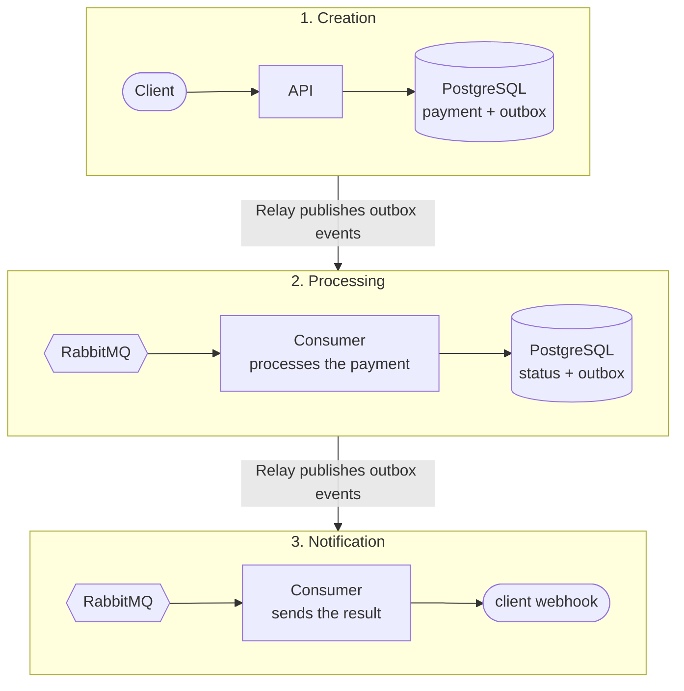

# Payment Service

Asynchronous payment processing service: accepts a payment request, runs it through a payment gateway (emulated)
and notifies the client of the result via webhook. Idempotent requests, transactional outbox, retry and DLQ.

---

## How to run

```bash
cp .env.template .env
cp config/config.template.toml config/config.toml
docker compose up --build
```

Once started, the following are available:

| Service | Address | Access |
|---|---|---|
| **Swagger UI** | [localhost:8000/docs](http://localhost:8000/docs) | header `X-API-Key: dev-secret-key` |
| **RabbitMQ UI** | [localhost:15672](http://localhost:15672) | `guest` / `guest` |

> The default API key `dev-secret-key` can be changed in `config/config.toml`.

---

### Try it

**1. Create a payment** ([webhook.site](https://webhook.site) is a handy place to receive the webhook):

```bash
curl -i -X POST http://localhost:8000/api/v1/payments \
  -H "X-API-Key: dev-secret-key" \
  -H "Idempotency-Key: $(uuidgen)" \
  -H "Content-Type: application/json" \
  -d '{
        "amount": "1500.00",
        "currency": "RUB",
        "description": "Order #123",
        "metadata": {"order_id": 123},
        "webhook_url": "https://webhook.site/<your-id>"
      }'
```

The service accepts the payment right away and processes it in the background:

```http
HTTP/1.1 202 Accepted

{"payment_id": "01a1970b-544a-7210-93e7-ce5592260c50", "status": "pending", "created_at": "2026-11-01T13:40:00Z"}
```

---

**2. Check its status** (in 2-5 seconds it becomes `succeeded` or `failed`):

```bash
curl http://localhost:8000/api/v1/payments/<payment_id> -H "X-API-Key: dev-secret-key"
```

---

**3. Receive the webhook.** The service sends a `POST` to your `webhook_url` with the final result:

```json
{
  "payment_id": "01a1970b-544a-7210-93e7-ce5592260c50",
  "idempotency_key": "9b2f7c1e-4d3a-4e8b-a6f5-0c1d2e3f4a5b",
  "status": "succeeded",
  "amount": "1500.00",
  "currency": "RUB",
  "description": "Order #123",
  "metadata": {"order_id": 123},
  "created_at": "2026-11-01T13:40:00Z",
  "processed_at": "2026-11-01T13:40:04Z"
}
```

Repeating a request with the same `Idempotency-Key` returns the same payment instead of creating a new one.

---

## What happens after a payment is created



**Retry and DLQ.** If processing fails, the message goes to a delay queue `*.retry.<n>` (2 s, then 4 s) and returns
to the work queue. After the third failure it ends up in `*.dlq`.

---

## Technologies

### Infrastructure

- **[PostgreSQL](https://www.postgresql.org/)** - main storage: payments and the outbox table
- **[RabbitMQ](https://www.rabbitmq.com/)** - message broker: queues, retry and DLQ
- **[Docker Compose](https://docs.docker.com/compose/)** - run all services with a single command

### Application

- **[FastAPI](https://fastapi.tiangolo.com/)** - HTTP API
- **[Pydantic](https://docs.pydantic.dev/)** - request and response validation
- **[SQLAlchemy](https://www.sqlalchemy.org/)** - ORM PostgreSQL
- **[Alembic](https://alembic.sqlalchemy.org/)** - database schema migrations
- **[FastStream](https://faststream.ag2.ai/)** - consumer and publisher for RabbitMQ
- **[Dishka](https://dishka.readthedocs.io/)** - dependency injection
- **[httpx](https://www.python-httpx.org/)** - sending webhooks to clients
- **[adaptix](https://adaptix.readthedocs.io/)** + **[orjson](https://github.com/ijl/orjson)** - config loading and fast serialization

### Code quality

- **[ruff](https://docs.astral.sh/ruff/)** - linter and formatter
- **[mypy](https://mypy-lang.org/)** - type checking
- **[import-linter](https://import-linter.readthedocs.io/)** - enforcing architecture layer boundaries
- **[pre-commit](https://pre-commit.com/)** - checks before every commit
- **[pytest](https://docs.pytest.org/)** + **[testcontainers](https://testcontainers-python.readthedocs.io/)** - unit and integration tests against a real PostgreSQL
